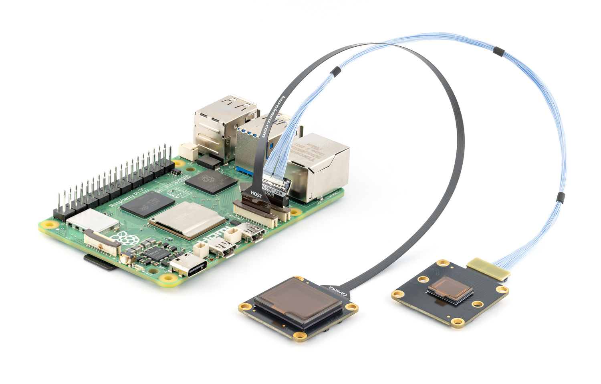

# AR0822 kernel driver for Raspberry Pi

[](https://github.com/Kurokesu/ar0822-rpi-driver/actions/workflows/build.yml)
[](https://github.com/Kurokesu/ar0822-rpi-driver/actions/workflows/code-style.yml)
[](https://github.com/Kurokesu/ar0822-rpi-driver/releases/latest)
[](https://apt.kurokesu.com)
[](https://www.raspberrypi.com/software/operating-systems/)
[](https://github.com/raspberrypi/linux/tree/rpi-6.12.y)

Raspberry Pi kernel driver for Onsemi AR0822, an 8 MP rolling shutter 1/1.8" back side illuminated CMOS sensor.

- 2-lane and 4-lane MIPI CSI-2 (up to 1280 Mbps/lane)
- 10-bit and 12-bit RAW output
- 3840×2160 @ 45 fps (full resolution)
- 1920×1080 @ 178 fps (2×2 binning)



*AR0822 camera modules are available at [kurokesu.com](https://www.kurokesu.com/item/822C-CSI)*

> [!NOTE]
> This driver supports an experimental eHDR mode, modeled after IMX708
> implementation, by exposing the standard `V4L2_CID_WIDE_DYNAMIC_RANGE` control.
> Read more in [eHDR (experimental)](#ehdr-experimental).

## Install

Connect camera to CSI port with Pi powered off.

Update OS and reboot:

```bash
sudo apt update && sudo apt full-upgrade -y
sudo reboot
```

> [!IMPORTANT]
> If driver or camera stack was previously built from source, run one-time cleanup before first apt install. See [migrating from a source install](#migrating-from-a-source-install).

Enable Kurokesu apt archive (skip if already enabled):

```bash
curl -fsSLO https://apt.kurokesu.com/setup.sh
sudo sh setup.sh
```

Install driver and camera stack:

```bash
sudo apt update
sudo apt install -y ar0822-rpi-dkms rpicam-apps
```

*With archive enabled, apt resolves Kurokesu `rpicam-apps` and `libcamera` forks with AR0822 support as updates to stock packages. Later updates arrive with regular `apt upgrade`.*

Edit boot configuration:

```bash
sudo nano /boot/firmware/config.txt
```

Make two changes:

1. Find `camera_auto_detect` near the top and set it to `0`:

```ini
camera_auto_detect=0
```

2. Add `dtoverlay=ar0822` under the `[all]` section at the bottom of the file:

```ini
[all]
dtoverlay=ar0822
```

*If camera is connected to cam0 port, use `dtoverlay=ar0822,cam0` instead. See [cam0](#cam0).*

Save and exit.

`config.txt` changes take effect after reboot:

```bash
sudo reboot
```

Verify camera is detected:

```bash
rpicam-hello --list-cameras
```

Expected output (varies by lane configuration):

```
Available cameras
-----------------
0 : ar0822 [3840x2160 12-bit GRBG] (/base/axi/pcie@1000120000/rp1/i2c@88000/ar0822@10)
    Modes: 'SGRBG10_CSI2P' : 1920x1080 [178.25 fps - (0, 0)/3840x2160 crop]
                             3840x2160 [45.33 fps - (0, 0)/3840x2160 crop]
           'SGRBG12_CSI2P' : 1920x1080 [153.68 fps - (0, 0)/3840x2160 crop]
                             3840x2160 [44.01 fps - (0, 0)/3840x2160 crop]
```

Start live preview:

```bash
rpicam-hello -t 0
```

On headless systems, capture a still image instead:

```bash
rpicam-still -o test.jpg
```

## dtoverlay options

`ar0822` overlay supports comma-separated options to override defaults:

| option | description | default |
|--------|-------------|---------|
| [`cam0`](#cam0) | Use cam0 port instead of cam1 | cam1 |
| [`4lane`](#4lane) | Use 4-lane MIPI CSI-2 (if wired) | 2 lanes |
| [`link-frequency=<Hz>`](#link-frequency) | Set MIPI CSI-2 link frequency (Hz) | 640000000 |
| `rotation=<deg>` | Sensor mounting rotation | 0 |
| `orientation=<n>` | Camera orientation (0 front, 1 back, 2 external) | 2 |

### cam0

If camera is connected to cam0 port, append `,cam0`:

```ini
dtoverlay=ar0822,cam0
```

### 4lane

To enable 4-lane MIPI CSI-2, append `,4lane`:

```ini
dtoverlay=ar0822,4lane
```

> [!WARNING]
> Before using `4lane`, confirm your camera port actually supports 4-lane MIPI CSI. Not all Raspberry Pi models and carrier boards provide 4-lane MIPI CSI on both ports.

### link-frequency

Supported link frequencies: 640 MHz (default) and 480 MHz.

To set link frequency to 480 MHz, append `,link-frequency=480000000`:

```ini
dtoverlay=ar0822,link-frequency=480000000
```

#### Output formats

| Link frequency | Data rate / lane | Lanes | Bit depth | Width | Height | Max FPS |
|---|---|---|---|---|---|---|
| **Full HD 1080p (2×2 binned)** | | | | | | |
| 480 MHz | 960 Mbps | 2 | 10 | 1920 | 1080 | 78.7 fps |
| 480 MHz | 960 Mbps | 2 | 12 | 1920 | 1080 | 66.6 fps |
| 480 MHz | 960 Mbps | 2 | 12 (eHDR) | 1920 | 1080 | 60.0 fps |
| 640 MHz | 1280 Mbps | 2 | 10 | 1920 | 1080 | 101.9 fps |
| 640 MHz | 1280 Mbps | 2 | 12 | 1920 | 1080 | 86.5 fps |
| 640 MHz | 1280 Mbps | 2 | 12 (eHDR) | 1920 | 1080 | 60.0 fps |
| 480 MHz | 960 Mbps | 4 | 10 | 1920 | 1080 | 120.1 fps |
| 480 MHz | 960 Mbps | 4 | 12 | 1920 | 1080 | 120.2 fps |
| 480 MHz | 960 Mbps | 4 | 12 (eHDR) | 1920 | 1080 | 60.0 fps |
| 640 MHz | 1280 Mbps | 4 | 10 | 1920 | 1080 | 178.3 fps |
| 640 MHz | 1280 Mbps | 4 | 12 | 1920 | 1080 | 153.7 fps |
| 640 MHz | 1280 Mbps | 4 | 12 (eHDR) | 1920 | 1080 | 60.0 fps |
| **4K 2160p (full resolution)** | | | | | | |
| 480 MHz | 960 Mbps | 2 | 10 | 3840 | 2160 | 21.3 fps |
| 480 MHz | 960 Mbps | 2 | 12 | 3840 | 2160 | 17.9 fps |
| 480 MHz | 960 Mbps | 2 | 12 (eHDR) | 3840 | 2160 | 16.9 fps |
| 640 MHz | 1280 Mbps | 2 | 10 | 3840 | 2160 | 27.9 fps |
| 640 MHz | 1280 Mbps | 2 | 12 | 3840 | 2160 | 23.5 fps |
| 640 MHz | 1280 Mbps | 2 | 12 (eHDR) | 3840 | 2160 | 22.2 fps |
| 480 MHz | 960 Mbps | 4 | 10 | 3840 | 2160 | 40.0 fps |
| 480 MHz | 960 Mbps | 4 | 12 | 3840 | 2160 | 33.9 fps |
| 480 MHz | 960 Mbps | 4 | 12 (eHDR) | 3840 | 2160 | 30.0 fps |
| 640 MHz | 1280 Mbps | 4 | 10 | 3840 | 2160 | 45.3 fps |
| 640 MHz | 1280 Mbps | 4 | 12 | 3840 | 2160 | 44.0 fps |
| 640 MHz | 1280 Mbps | 4 | 12 (eHDR) | 3840 | 2160 | 30.0 fps |

*4K 10-bit on 4 lanes is limited to 45.3 fps by RP1, which processes up to 390 Mpix/s on Pi 5.*

> [!TIP]
> Options can be combined. Example (cam0, 4-lane):
> ```ini
> dtoverlay=ar0822,cam0,4lane
> ```

## eHDR (experimental)

AR0822 features an on-sensor HDR mode that expands dynamic range up to 96 dB by combining 2 exposures within sensor using MEC algorithm. To reduce bandwidth requirements, linearized 16-bit HDR signal is companded to a 12-bit output.

> [!IMPORTANT]
> libcamera pipeline is designed for linear image data from sensor. Kurokesu's libcamera fork decompands eHDR data on Pi 5. Pi 4 ISP has no decompanding, so colors there are approximate.

eHDR mode is enabled by appending `--hdr` to `rpicam` commands.

### List eHDR modes

```bash
rpicam-hello --list-cameras --hdr
```

```
Available cameras
-----------------
0 : ar0822 [3840x2160 12-bit GRBG] (/base/axi/pcie@1000120000/rp1/i2c@88000/ar0822@10)
    Modes: 'SGRBG12_CSI2P' : 1920x1080 [60.01 fps - (0, 0)/3840x2160 crop]
                             3840x2160 [30.00 fps - (0, 0)/3840x2160 crop]
```

## Build from source

Install required tools:

```bash
sudo apt install -y git
sudo apt install -y --no-install-recommends dkms
```

Clone this repository:

```bash
cd ~
git clone https://github.com/Kurokesu/ar0822-rpi-driver.git
cd ar0822-rpi-driver/
```

If driver was installed from apt archive previously, remove it first:

```bash
sudo apt remove ar0822-rpi-dkms
```

Run install script:

```bash
sudo ./install.sh
```

Camera stack, boot configuration and verification follow [Install](#install). Skip `ar0822-rpi-dkms` there, only `rpicam-apps` is needed. To build `libcamera` and `rpicam-apps` from source as well, see [libcamera/BUILDING.md](https://github.com/Kurokesu/libcamera/blob/kurokesu/BUILDING.md).

Run uninstall script to remove driver:

```bash
sudo ./uninstall.sh
```

*`uninstall.sh` removes every `ar0822` version installed from source.*

Remove `dtoverlay=ar0822` from `/boot/firmware/config.txt`, then reboot.

## Migrating from a source install

One-time cleanup before first apt install.

Remove `ar0822` driver installed from source:

```bash
cd ~/ar0822-rpi-driver
git pull
sudo ./uninstall.sh
```

*`uninstall.sh` ships with 0.2.0 and later.*

Source-built `libcamera` and `rpicam-apps` install to `/usr/local` and shadow packaged binaries. Remove them:

> [!WARNING]
> Command below deletes everything under `/usr/local` with `libcamera`, `rpicam` or `libpisp` in its name, including custom scripts or files named after them.

```bash
sudo find /usr/local -depth \( -name '*libcamera*' -o -name '*rpicam*' -o -name '*libpisp*' \) -exec rm -rf {} +
```

Cleanup complete. Continue with [install steps](#install).

## Special thanks

- [Will Whang](https://github.com/will127534) for [imx585-v4l2-driver](https://github.com/will127534/imx585-v4l2-driver), used as basis for structuring this driver.
